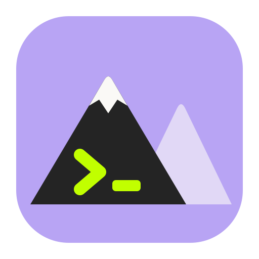

<p align="center"></p>

# Toros

**The friendliest terminal for people who build things.** A native macOS terminal with a warm, minimal interface built around your projects.
Real shells, GPU-accelerated rendering (Ghostty's engine), workspaces, tabs, split panes, git and port awareness, and a command palette.

Local-first: **no account, no telemetry, no network access** for any core feature, no AI service required.
Works with Claude Code, OpenCode and Codex (launch tested).

> **Early release (0.x).** This repository only hosts downloads, release notes and the issue tracker. Toros itself is closed-source.

## Install

macOS 14 or newer (Apple silicon and Intel builds in one app).

```sh
curl -fsSL https://raw.githubusercontent.com/ardakaano/toros-releases/main/install.sh | bash
```

It downloads the newest DMG, verifies its SHA-256, copies **Toros.app** to `/Applications` and opens it. No `sudo`. Read the [script](install.sh) first if you like.

Prefer to do it by hand? Download `Toros-<version>.dmg` from [Releases](../../releases), check it against the `.sha256` file
(`shasum -a 256 -c Toros-*.dmg.sha256`), and drag Toros to Applications.

**Uninstall:** delete `/Applications/Toros.app`. Your settings live in `~/Library/Application Support/Toros/` (delete it to reset).

## Signed and notarized

Releases are signed with a Developer ID (`Arda Kaan Özcan, TTHQABHB4H`) and notarized by Apple, so a DMG downloaded in a browser opens without a Gatekeeper warning.
Verify it yourself: `spctl --assess --type execute -vv /Applications/Toros.app` should print `source=Notarized Developer ID`.

## Verified, and not

Each release is tested end-to-end on the exact binary you download (real shells, vim, nano, top, resize, split panes, copy/paste, git/port/process indicators, launching Claude Code, OpenCode and Codex).
Not yet verified: Intel Macs, macOS 14/15, VoiceOver. The notes of each release list the current numbers and known gaps.

## Report a problem

[Open an issue](../../issues/new). Please include your macOS version, chip (Apple silicon / Intel), what you did, and what you expected.
**Never paste secrets, tokens or private terminal output.**

## Legal

Toros bundles open-source software; full notices are in [THIRD_PARTY_NOTICES.md](THIRD_PARTY_NOTICES.md) and inside the app
(`Toros.app/Contents/Resources`). Includes Ghostty's terminal engine (MIT), Termini (MIT), SwiftTerm (MIT) and others.
Portions of this software are copyright © The FreeType Project (www.freetype.org). All rights reserved.
Toros itself is proprietary, © 2026 Toros. All rights reserved.
